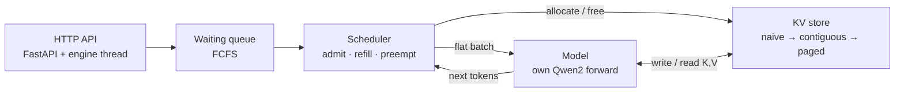

# vllm-lite

A from-scratch LLM inference server implementing **continuous batching** and **paged KV-cache management**, benchmarked against naive serving. Built to understand how systems like [vLLM](https://github.com/vllm-project/vllm) achieve high-throughput LLM serving.

> **Status: work in progress (phase 1 of 6).** Results below are filled in as each phase lands. Nothing in this README is a number I haven't measured.

---

## What it does

Many clients send prompts over HTTP at the same time. Instead of answering them one by one, the server keeps up to N requests running together on one GPU:

- **Continuous batching.** Every step runs one forward pass for *all* active sequences. The moment one finishes, a waiting request takes its seat on the very next step. No slot sits idle waiting for a batch to drain ([Orca](https://www.usenix.org/conference/osdi22/presentation/yu), iteration-level scheduling).
- **Paged KV cache.** GPU memory for keys and values is split into fixed-size blocks. Each sequence holds a block table and takes blocks only as it grows, so memory isn't reserved for the worst case ([PagedAttention](https://arxiv.org/abs/2309.06180)).
- **Admission control and preemption.** The scheduler admits a request only when KV memory exists. When memory runs out mid-generation, it preempts the newest sequence and recomputes it later.

The model, [Qwen2.5-0.5B-Instruct](https://huggingface.co/Qwen/Qwen2.5-0.5B-Instruct), is a fixed black box. All the engineering is in the layer around it: scheduling, memory, and concurrency.

## Architecture



One engine step:

```text
seqs   = scheduler.schedule()        # who runs; reserves KV memory for each
batch  = build_batch(seqs)           # every token of every sequence, flattened
logits = model(batch)                # ONE forward pass: new prefills + all decodes
tokens = argmax(logits)              # greedy, one per sequence
scheduler.postprocess(seqs, tokens)  # record tokens, retire finished, free their KV
```

## Design decisions

- **Own forward pass instead of Hugging Face's cache.** HF's cache assumes one rectangular, padded batch. Continuous batching mixes sequences of different lengths joining and leaving every step, and paging needs full control of where each key and value lives. HF is used only to load weights and as the correctness reference.
- **Ragged batching.** All tokens from all sequences are concatenated into one flat batch. Projections, norms, and the MLP are per-row, so they run on the whole batch at once. Only attention mixes tokens, so only attention loops over sequences.
- **Gather-based paged attention, no CUDA kernels.** A sequence's blocks are gathered into a temporary contiguous tensor with normal PyTorch indexing, then standard attention runs on it. This is slower than vLLM's fused kernel, but the allocator logic is the same. Writing kernels would cost months for no added insight.
- **Correctness first.** Every batching, cache, and preemption change is tested token-for-token against Hugging Face greedy output.

## Results

_Workload: [N] requests, prompts [a–b] tokens, outputs [c–d] tokens, seed 0. Hardware: NVIDIA RTX 3050 Laptop, 4 GB VRAM. KV budget for runs 4–5: [X] MB._

| Run | Setup | Throughput (tok/s) | p50 latency | p99 latency | Peak concurrent seqs |
|---|---|---|---|---|---|
| 1 | HF model, one request at a time | – | – | – | 1 |
| 3 | continuous batching, naive KV | – | – | – | – |
| 4 | contiguous KV, worst-case slots | – | – | – | – |
| 5 | paged KV, same budget | – | – | – | – |

<!--  -->

### Why each number moved

- **1 → 3:** _to be written after phase 3._
- **3 → 4:** _to be written after phase 4._
- **4 → 5:** _to be written after phase 5._

## Roadmap

- [x] Environment, model loading, attention fundamentals
- [ ] **Phase 1:** own token-by-token generation loop, without and with KV cache
- [ ] **Phase 2:** naive baseline + benchmark harness (throughput, TTFT, p50/p99)
- [ ] **Phase 2.5:** own Qwen2 forward pass (RMSNorm, RoPE, GQA, SwiGLU), logits matching HF
- [ ] **Phase 3:** scheduler with continuous batching
- [ ] **Phase 4:** contiguous KV cache under a memory budget, with admission control
- [ ] **Phase 5:** paged KV cache with block allocator and preemption
- [ ] **Phase 6:** HTTP API, concurrent load testing, final benchmarks

## Project layout

```text
phase1/gen_loop.py      manual generation loop (no cache vs cache)
vllm_lite/
  model.py              Qwen2 forward pass on a ragged batch
  batch.py              scheduled sequences -> one flat batch
  kv_cache.py           naive, contiguous and paged KV stores
  scheduler.py          admission, refill, preemption
  engine.py             the step loop
  server.py             FastAPI + background engine thread
bench/                  workload generator, offline + HTTP benchmarks, charts
tests/                  CPU tests on a tiny random Qwen2; GPU tests on the real model
DEVLOG.md               session-by-session build log
```

## Running it

```bash
# Setup: install PyTorch with CUDA first (pytorch.org), then
pip install -r requirements.txt

# Tests: CPU, tiny random model, no download needed
pytest tests -q
pytest tests/test_gpu.py -v -s          # real model, needs CUDA

# Benchmarks
python -m bench.bench_offline --backend hf     --name 1_naive_hf
python -m bench.bench_offline --backend engine --kv paged --kv-mem-mb 256 --name 5_paged
python -m bench.plot

# Server
python -m vllm_lite.server --kv paged
curl -s localhost:8000/generate -H 'content-type: application/json' \
     -d '{"prompt": "What is a KV cache?", "max_new_tokens": 64}'
```

## Limitations

- Single GPU, single node: no tensor parallelism or distributed serving.
- Greedy decoding only.
- No custom CUDA kernels; attention runs per sequence in Python.
- Benchmarks use synthetic random-token prompts with fixed output lengths.

## References

- Yu et al., [Orca: A Distributed Serving System for Transformer-Based Generative Models](https://www.usenix.org/conference/osdi22/presentation/yu), OSDI 2022
- Kwon et al., [Efficient Memory Management for Large Language Model Serving with PagedAttention](https://arxiv.org/abs/2309.06180), SOSP 2023
- Vaswani et al., [Attention Is All You Need](https://arxiv.org/abs/1706.03762), 2017
- Karpathy, [nanoGPT](https://github.com/karpathy/nanoGPT)